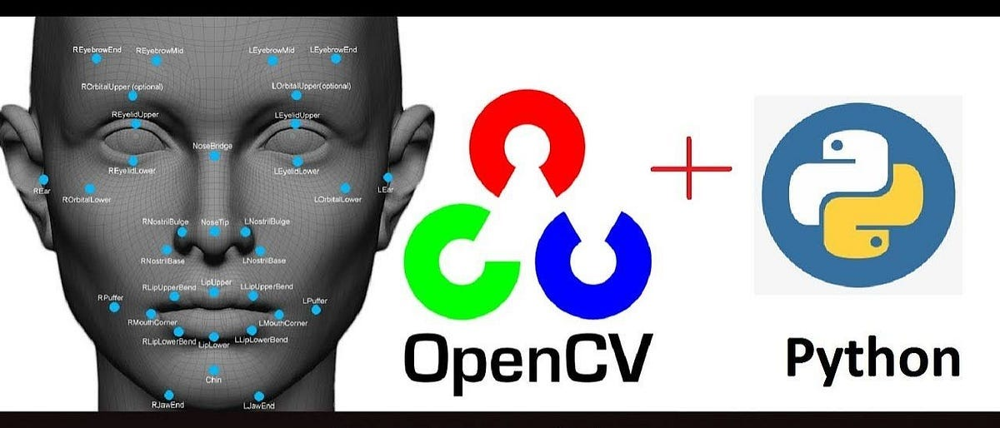
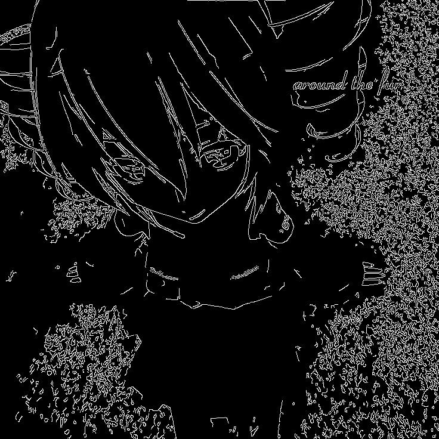
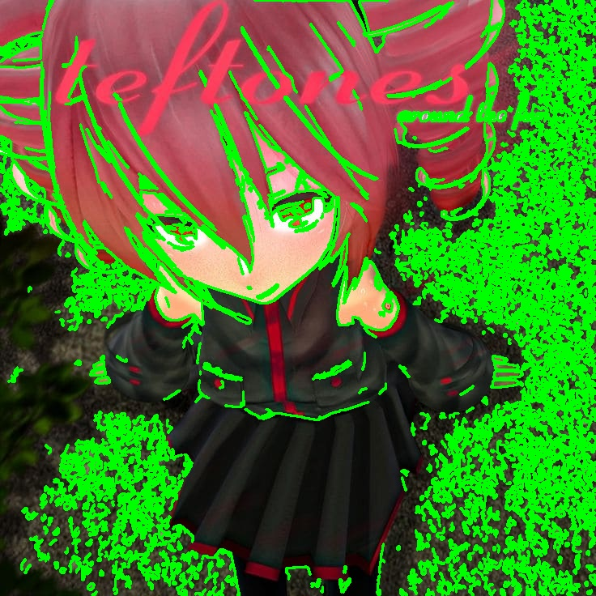
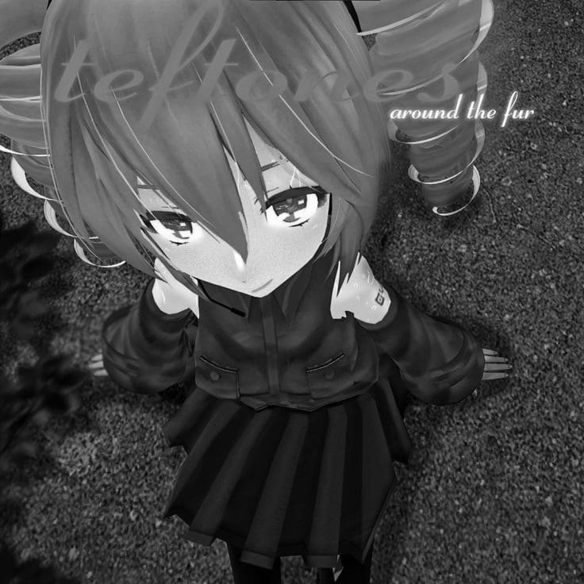
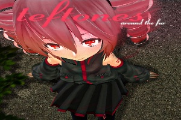
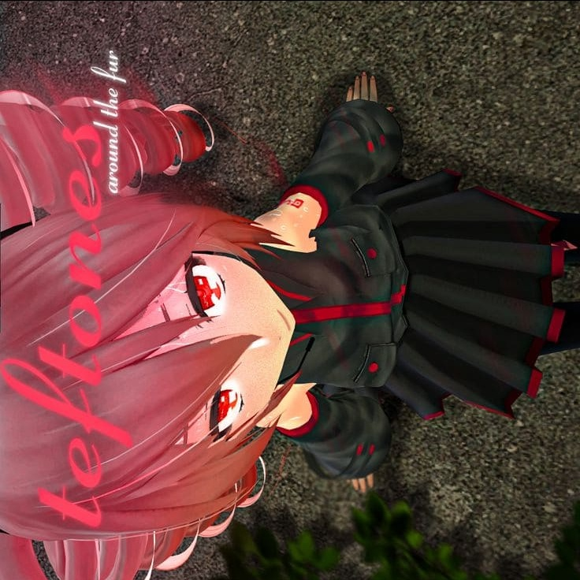
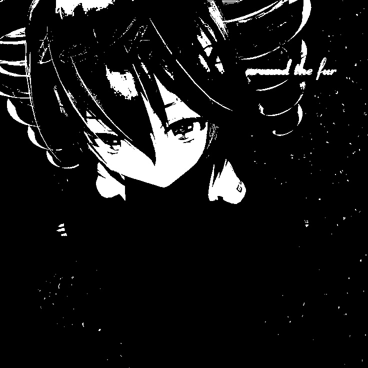
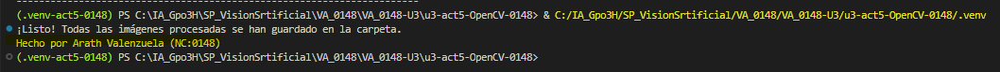

# UIII Act 5 OpenCV Practica Alumno
## Arath Jacobo Valenzuela Montoya (NC:0148)
###  20 de Noviembre del 2026

## Fuente/Link original del código 

https://bhavikjikadara.medium.com/image-processing-using-opencv-a-step-by-step-guide-e589b0acbbf3

### El procesamiento de imágenes es un componente fundamental en campos modernos como la inteligencia artificial, la visión artificial y la robótica. OpenCV, una potente biblioteca de código abierto, permite a los desarrolladores gestionar tareas complejas relacionadas con imágenes de manera sencilla. Este blog te guiará a través de técnicas esenciales de procesamiento de imágenes utilizando Python, abarcando desde la lectura y visualización de imágenes, la conversión de espacios de color y el cambio de tamaño, hasta tareas más avanzadas como la detección de bordes, la detección de contornos y la umbralización. Mediante ejemplos prácticos, aprenderás a manipular y mejorar imágenes sin esfuerzo.

## Imagen original

## Bordes 

## Contornos

## Desenfocada

## Formas con texto

## Grises

## Redimensionada

## Rotada

## Umbral

## Resultados en terminal
